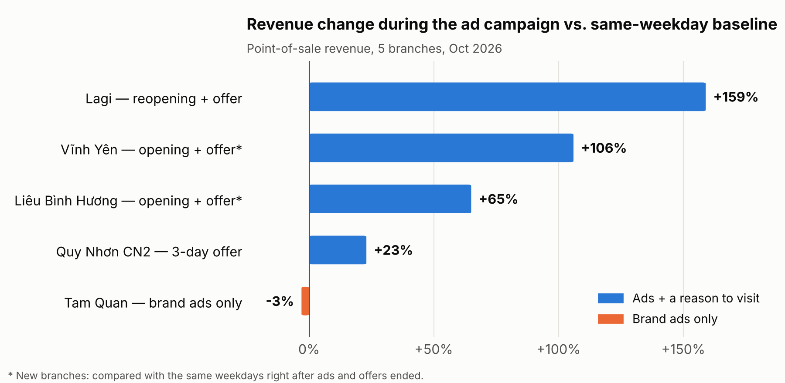
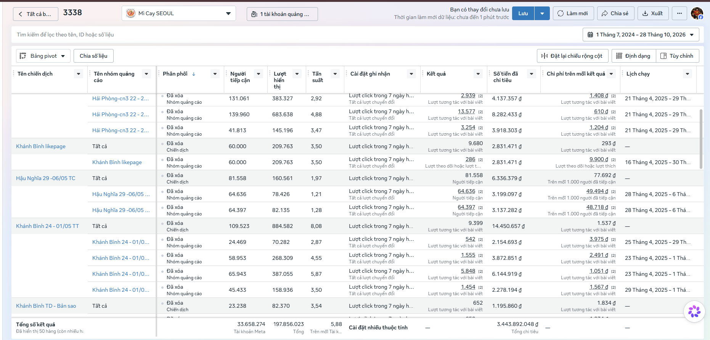
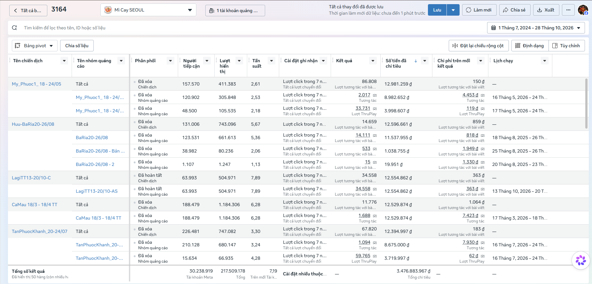
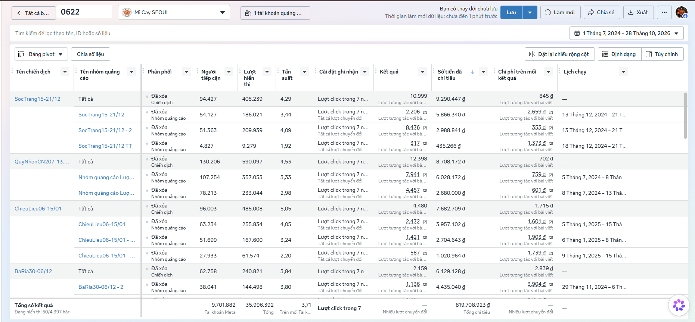
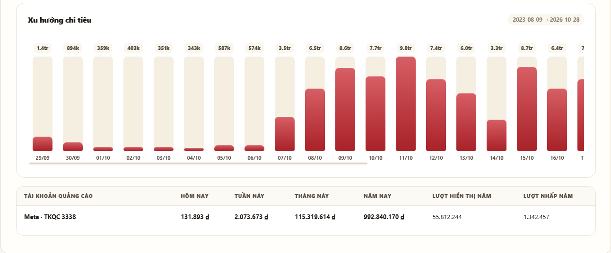
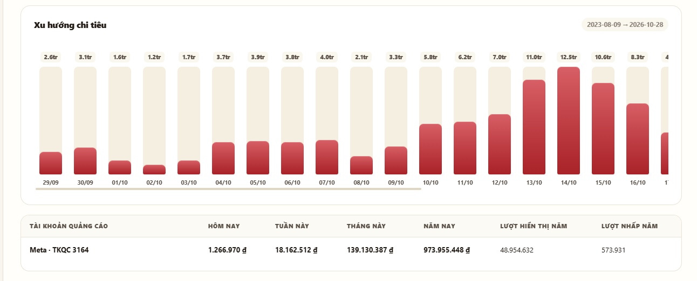
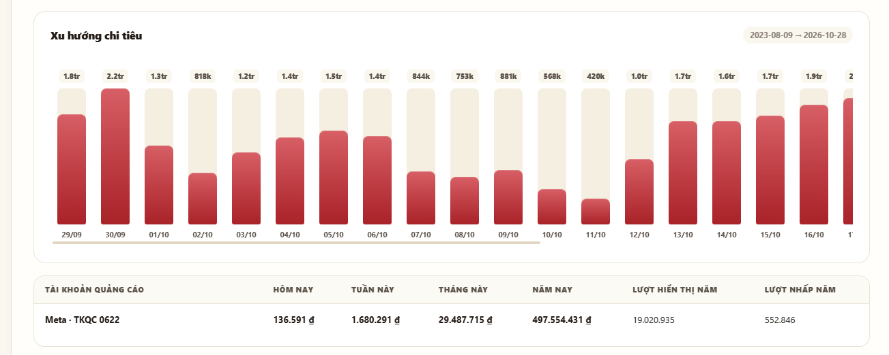
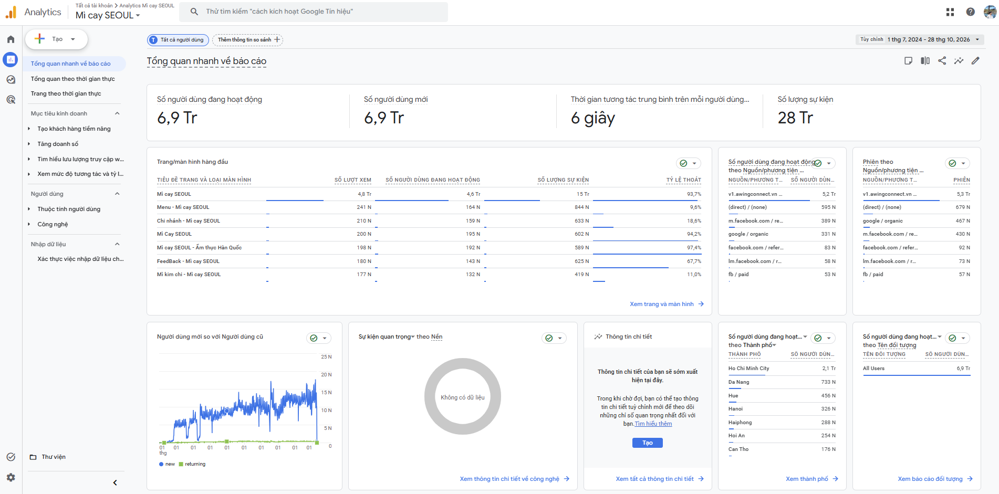
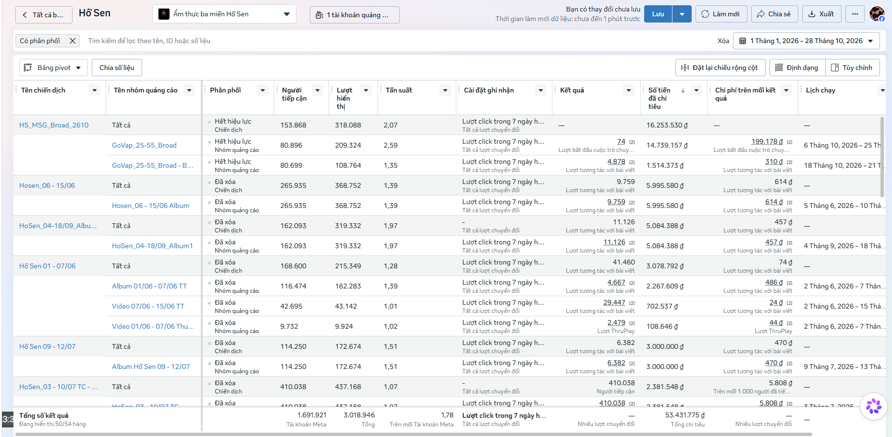

# Facebook Ads Case Studies — Phạm Quốc Toàn

> 🇻🇳 Kết quả chạy Facebook Ads thực tế: **\~7,74 tỷ VNĐ ngân sách**, **451 triệu lượt hiển thị** cho chuỗi **\~200 chi nhánh** Mì Cay SEOUL (07/2024 – 10/2026). Ảnh chụp trực tiếp từ Meta Ads Manager và Google Analytics, chỉ che ID tài khoản. Hiệu quả được đo bằng cả doanh thu POS thực tế tại quán.

All numbers below come straight from **Meta Ads Manager** and **Google Analytics 4**. Screenshots are unedited except for hidden ad account IDs. I'm happy to walk through the live accounts on a screen share during an interview.

---

## At a glance

| | |
|---|---|
| 💰 Total ad spend managed | **7.74B VND (\~$300K)** |
| 📅 Period | 07/2024 – 10/2026 (28 months), \~276M VND/month |
| 🏪 Scale | **\~200 restaurant branches**, Hai Phong → Ca Mau |
| 👀 Impressions | **451M** |
| 👥 Reach (largest account) | **33.7M people** |
| 💸 Average CPM | **\~17,100 VND** |
| 🖱️ 2026 CTR / CPC | **\~2.0% / \~1,000 VND** |
| 🏪 Ads → store revenue | **+23% to +159%** for campaigns with an opening or offer (POS data, 5 branches) |
| 🏷️ Industries | F&B chain, restaurant |

---

## Case study 1 — Mì Cay SEOUL (Korean noodle chain, \~200 branches)

**Role:** Digital Marketing & IT, running all Facebook Ads since 07/2024.
**Goal:** Drive foot traffic to physical stores — brand awareness for new openings and promotions, plus staff recruitment for every branch. No online sales, so success is measured by reach, cost efficiency and in-store traffic.

### Strategy

1. **One ad account per purpose**, so budgets and reporting never mix:

   | Account | Purpose |
   |---|---|
   | A | New branch openings |
   | B | Promotions |
   | C | Recruitment |

2. **One campaign per branch**, named by branch + run dates, with **video and standard-post variants split** to compare creative performance.
3. **Location targeting by branch type**: 3–5 km radius in big-city centres, 5–7 km elsewhere.
4. **Creatives I shoot and edit myself**: food videos and photo albums, promotion and grand-opening content, reused across Facebook Reels and TikTok.
5. **Daily monitoring with a dashboard I built** (Meta API → spend per account per day), plus scheduled multi-phase budgets.

### Results (01/07/2024 – 28/10/2026)

| Account | Spend (VND) | Reach | Impressions | Frequency | CPM (VND) |
|---|---|---|---|---|---|
| A – Openings | 3,443,892,048 | 33,658,274 | 197,856,023 | 5.88 | \~17,400 |
| B – Promotions | 3,476,883,967 | 30,238,919 | 217,509,178 | 7.19 | \~16,000 |
| C – Recruitment | 819,708,923 | 9,701,882 | 35,996,392 | 3.71 | \~22,800 |
| **Total** | **7,740,484,938** | — | **451,361,593** | — | **\~17,100** |

*Reach is not summed across accounts because the same person can be reached by several accounts.*

**2026 so far:** 2.47M clicks, CTR \~2.0% (above the \~1–1.5% often cited for Facebook ads), CPC \~1,000 VND.

**Campaign examples** (from the screenshots below):

| Campaign | Type | Result | Cost per result |
|---|---|---|---|
| Mỹ Phước 1 — 18–24/05/2026 | Promotion | 86,808 post engagements | 150 VND |
| Tân Phước Khánh — 20–24/07/2026 | Promotion | 67,820 post engagements | 183 VND |
| Lagi — 13–20/10/2026 | Promotion | 34,558 post engagements | 363 VND |
| Hậu Nghĩa — 28/04–06/05/2025 | Opening (reach) | 81,558 people reached | 77,692 VND / 1,000 people |
| Quy Nhơn CN2 — 07/2024 | Recruitment | 12,398 post engagements | 702 VND |

**Ads → website:** Facebook brought **\~580K users** to the brand website (which I also built), alongside 331K from Google organic search.

### Ads → in-store revenue (POS data)

Reach and engagement don't prove that people walked in, so I matched campaigns against **daily point-of-sale revenue** (CUKCUK / MMENU) for 5 branches. Each campaign period is compared with the **same weekdays** before the campaign (public holidays excluded); new branches are compared with the days right after their opening ads and offers ended.

| Branch | Situation | Ad spend (VND) | During campaign | After ads stopped |
|---|---|---|---|---|
| Lagi | Reopening after renovation + offer | 12.55M | **+159%** | **+62%** |
| Vĩnh Yên | New branch opening + offer | 22.16M | **+106%** | — |
| Liêu Bình Hương | New branch opening + offer | 13.08M | **+65%** | — |
| Quy Nhơn CN2 | 3-day offer | 3.16M | **+23%** (offer days) | −14% |
| Tam Quan | Brand ads only, no offer | 10.45M | −3% | +2% |

*Revenue figures are shown as % change only; absolute store revenue stays private.*

**What I learned**

1. **Ads need a reason to visit.** Every campaign tied to an opening, reopening or offer lifted revenue; brand-only ads (Tam Quan, and Quy Nhơn's ads-only day) showed no measurable change.
2. **Short offers mostly pull visits forward.** In Quy Nhơn the +23% during the offer was followed by −14% the next week, netting out to about zero. Openings and reopenings brought in customers who kept coming back (Lagi stayed +62% a week later).
3. **More budget isn't proportionally more revenue.** Vĩnh Yên had 1.7× Liêu Bình Hương's ad spend but returned roughly a third as much extra revenue per ad dong (about 3.6 vs about 10). Two openings is a hint, not a rule yet.

*Caveats: openings and offers lift revenue on their own, so these numbers measure the whole campaign (ads + offer + event), not ads in isolation. Results cover October 2026; more branches will be added.*

### Screenshots

**Account A — openings, lifetime totals**

**Account B — promotions, lifetime totals**

**Account C — recruitment, lifetime totals**

**Daily spend dashboard I built (Meta API)**

**Website traffic (GA4)** — the large `awingconnect` source is in-store Wi-Fi marketing I set up; organic traffic is \~1.7M users.

---

## Case study 2 — Ẩm Thực 3 Miền Hồ Sen (restaurant)

**Period:** 05/2026 – now · **Goal:** bring diners in and take table bookings.

| Spend | Reach | Impressions | Frequency | CPM |
|---|---|---|---|---|
| 53,431,775 VND | 1,691,921 | 3,018,946 | 1.78 | \~17,700 VND |

- Photo-album and food-video creatives: **24–614 VND per engagement**; best video reached 29,447 engagements at 24 VND each.
- Low frequency (1.78): wide coverage with little repetition.
- Testing a **Messenger booking campaign** (10/2026): 74 conversations started at \~199K VND each — much more expensive than engagement campaigns, so this channel is still being optimised.

---

## How to verify

- **Live screen share** of Ads Manager and GA4 during an interview
- Ads currently running are visible to anyone in the [Meta Ad Library](https://www.facebook.com/ads/library/) (search "Mì Cay SEOUL")
- Brand website: [micayseoul.com.vn](https://micayseoul.com.vn/)

---

**Contact:** toanpq99@gmail.com · GitHub [@toanpq99](https://github.com/toanpq99)
